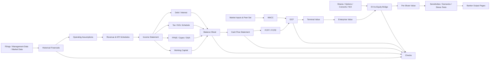

# The Banker-Ready DCF: Architecture, Numerical Methodology, and Review Standard

## Executive summary

A best-in-class discounted cash flow model is not the spreadsheet with the greatest number of tabs or formulas. It is the **smallest fully integrated model that makes the operating thesis, accounting mechanics, valuation assumptions, and sources of uncertainty explicit enough that another banker can trace, challenge, and reproduce the result quickly**. The fundamental valuation discipline is simple but unforgiving: cash flows to the firm must be discounted at a firm-level required return such as WACC, while cash flows to equity must be discounted at the cost of equity; mixing cash-flow definitions and discount rates is a conceptual error even when the spreadsheet mechanically calculates. Damodaran's DCF framework makes this cash-flow/discount-rate matching a first principle, while recent Wall Street Prep guidance similarly identifies operating assumptions, WACC, and terminal value as the three central DCF assumption families. citeturn4view1turn21search2

For a typical non-financial corporate, the strongest banker-ready implementation is therefore an **integrated three-statement forecast feeding an unlevered FCFF DCF**, with detailed supporting schedules for revenue, working capital, PP&E/depreciation, tax/NOLs, debt/interest, and shares/dilution. A three-statement model forecasts the income statement, balance sheet, and cash flow statement together; the cash-flow statement should reconcile the operating and balance-sheet forecasts rather than behave as an independent hard-coded forecast. SEC reporting itself is organized around the balance sheet, income statement, cash-flow statement, and shareholders' equity statement, reinforcing why a professional model must reconcile these views of the same business. citeturn15search10turn16search2

The valuation engine should be downstream of the operating model rather than intermingled with it. In a review-ready workbook, a reviewer should be able to move in a clear direction: **sources → historical financials → assumptions → operating schedules → three statements → FCF → WACC → terminal value → enterprise-to-equity bridge → per-share value → sensitivity/risk outputs → checks**. ICAEW's Financial Modelling Code emphasizes deliberate model design, flexible scenario capability, and avoiding version-control risks from unnecessarily fragmented workbooks; its spreadsheet principles separately call for checks, controls, and alerts from the outset. citeturn15search1turn15search17

The explicit forecast should extend until the company is economically capable of entering a sustainable state, rather than stopping mechanically because five years have elapsed. Five-to-ten-year two-stage DCFs are common in practice, but the true test is whether revenue growth, margins, reinvestment, leverage, returns on capital, and risk have converged toward plausible mature levels. Terminal growth cannot be treated independently from reinvestment: in steady state, growth is supported by reinvestment and returns on incremental capital, so \(g = \text{Reinvestment Rate}\times ROIC\). Damodaran explicitly recommends making reinvestment a function of growth and return on capital rather than obtaining "free" perpetual growth. citeturn21search2turn16search0turn16search12

A strong terminal value section should calculate **both a perpetuity-growth value and an exit-multiple cross-check**, but it should normally treat the perpetuity method as the more intrinsically consistent DCF method. An exit multiple is useful because bankers and buyers think in market multiples, yet it partially turns the DCF back into a relative valuation. Damodaran explicitly distinguishes stable-growth valuation from terminal-multiple valuation on this basis, while current Wall Street Prep materials identify the perpetuity-growth and exit-multiple methods as the two principal techniques used in practice. citeturn16search0turn15search30

WACC must be a **market-value, forward-looking opportunity cost of capital**, not a mechanical assembly of whatever figures are easiest to find. The preferred beta methodology for most public-company DCFs is a bottom-up peer beta: select operationally comparable companies, unlever their observed equity betas, normalize the set, and relever the resulting asset beta to the subject company's target capital structure. Hamada's seminal 1972 work formalized the relationship between capital structure and systematic equity risk; Damodaran's current industry datasets publish both levered and unlevered betas precisely because leverage materially affects observed equity beta. citeturn17search1turn20search1

Country and size premiums deserve particular discipline. Country risk should reflect **where operating cash flows are exposed**, not merely the legal domicile of the company; Damodaran describes revenue-weighted country exposure and publishes a country-risk methodology in which sovereign default spreads can be scaled by relative equity-market volatility. Kroll's current cost-of-capital platform likewise separately provides country-risk, ERP, beta, and size-premium data. Size premium is a recognized practitioner input but not an automatic extension of textbook CAPM; Fama and French's classic 1992 evidence showed that size and book-to-market captured return variation not explained by market beta, which is one reason size-related adjustments exist, but that evidence does not justify adding an arbitrary size premium on top of every CAPM estimate. citeturn20search0turn20search20turn15search3turn17search5

The model's enterprise-to-equity bridge deserves the same care as the DCF itself. Consolidated enterprise value must be adjusted for excess cash, debt, preferred stock, lease liabilities where treated as financing, non-operating investments, non-controlling interests, pensions or other debt-like claims where appropriate, and option/convertible claims. IFRS 10 defines non-controlling interests as subsidiary equity not attributable to the parent; therefore, when consolidated FCFF incorporates 100% of a controlled subsidiary, the value attributable to NCI must be removed to arrive at common equity attributable to the parent. Damodaran similarly stresses that warrants and conversion options are separate equity claims that cannot simply disappear when total equity value is divided by basic shares. citeturn18search1turn16search1turn16search7

Finally, a banker-ready DCF should not communicate a single point estimate as if it were known with precision. It should show a base case plus coherent bull/bear cases, two-dimensional sensitivity tables, terminal-method cross-checks, and explicit stress tests. Monte Carlo is valuable when distributions and correlations can be defensibly specified because it produces a distribution rather than a single valuation; WIPO's valuation guidance describes this advantage directly. It should supplement—not replace—scenario and sensitivity analysis because simulation captures assumed parameter uncertainty but cannot eliminate structural/model risk. citeturn21search0

**Assumptions used in this report.** Industry, company maturity, accounting framework, tax jurisdiction, currency, fiscal year-end, valuation date, transaction context, and public/private status were not specified. The canonical model below therefore assumes a **non-financial operating company**, nominal cash flows, an unspecified reporting currency, ordinary corporate taxation, and consolidated financial reporting. Financial institutions, insurers, highly regulated utilities, early-stage biotechnology, natural-resource assets, distressed companies, and finite-life project companies often require material alterations to the standard FCFF/WACC framework. All numerical percentages below that are labeled “illustrative” are examples rather than current market recommendations. Market inputs such as risk-free rates, ERPs, credit spreads, foreign-exchange rates, and tax law must be refreshed as of the actual valuation date; Kroll, for example, explicitly reassesses ERP and corresponding risk-free-rate guidance as market conditions change. citeturn15search7

## Scope, architecture, and banker standard

**The governing equation.** For a standard enterprise DCF, enterprise value equals the present value of explicit-period free cash flow to the firm plus the present value of terminal value:

\[
EV_0=
\sum_{t=1}^{N}
\frac{FCFF_t}{(1+WACC)^{d_t}}
+
\frac{TV_N}{(1+WACC)^{d_{TV}}}
\]

where \(d_t\) represents the exact or convention-based discount period. Damodaran defines firm valuation as discounting cash flows available to all capital providers at the weighted-average cost of capital; equity valuation instead discounts equity cash flows at the cost of equity. citeturn15search32turn4view1

For businesses whose cash generation is reasonably continuous through the year, **mid-year discounting** is generally preferable to mechanically assuming every annual cash flow is received on the fiscal year-end. Wall Street Prep's current DCF guidance describes the mid-year convention as treating annual FCF as if generated at the midpoint because actual cash movements occur throughout the period. For strongly seasonal or transaction-like cash flows, however, exact timing or quarterly/monthly modeling is preferable to a generic midpoint assumption. citeturn15search2

The typical annual mid-year exponent is:

\[
d_t=t-0.5
\]

Thus:

\[
PV(FCFF_t)=\frac{FCFF_t}{(1+WACC)^{t-0.5}}
\]

One frequently missed detail is that the **terminal value itself normally exists at the end of the final explicit year**, not at the midpoint at which Year \(N\)'s operating FCF is assumed received. The model should therefore distinguish the final-year FCF discount period from the terminal-value period. A stub-period DCF should go further and use actual dates or fractional-year periods rather than blindly applying 0.5, 1.5, 2.5, and so forth.

**Recommended workbook architecture.** The exact tab count should scale with company complexity, but the following layout is a strong default. ICAEW recommends clear structure, flexible design, and separation that makes models understandable and maintainable; Wall Street Prep likewise emphasizes integrated operating and roll-forward schedules in a three-statement model. citeturn15search1turn21search25

| Tab | Purpose | Banker-review standard |
|---|---|---|
| `Cover_Control` | Company, valuation date, currency, units, author/reviewer, version, active case | No calculations beyond control flags |
| `Sources_Historicals` | Filing/management-data extraction | Every hardcode traceable to source/date |
| `Assumptions` | Base/bull/bear operating and valuation inputs | Inputs separated from calculations |
| `Revenue_KPIs` | Volume, price, users, stores, ARR, backlog, segment drivers | Bottom-up where economically meaningful |
| `Income_Statement` | Historical and projected P&L | GAAP/IFRS to adjusted bridge visible |
| `Working_Capital` | AR, inventory, AP, deferred revenue, accruals, other operating WC | Days/turnover or driver-based |
| `PP&E_D&A` | Capex, disposals, depreciation, asset cohorts | Full roll-forward |
| `Tax_NOL` | Book tax, cash tax, temporary items, NOL roll-forward | Jurisdiction-specific rules documented |
| `Debt_Interest` | Debt by tranche, rates, amortization, cash sweep/revolver | Average-balance interest where practical |
| `Equity_Dilution` | Shares, options, RSUs, converts, buybacks | Bridge to fully diluted/common-equity claims |
| `BS_CFS` | Integrated balance sheet and cash-flow statement | Fully reconciled |
| `WACC` | Peer betas, capital structure, cost of equity/debt | Sources and as-of dates visible |
| `DCF` | FCFF, discount factors, TV, EV-equity bridge | No new operating assumptions |
| `Sensitivities_Risk` | WACC/g, WACC/multiple, scenarios, stress tests, Monte Carlo | Base-case center tie-out |
| `Outputs` | Valuation summary, charts, football field, assumptions | Presentation-ready |
| `Checks_Audit` | Consolidated checks and exception flags | Must be clean before circulation |

A smaller model can combine several schedules; a complex carve-out, multi-segment company, or transaction model may require more. The design principle is **one clear home for each assumption and one clear calculation path**, rather than tab proliferation for its own sake. ICAEW specifically recommends model structures that are flexible enough to extend and that avoid unnecessary multiple-workbook version risk. citeturn15search1

The logical model flow should look like this:



The time axis should also be unmistakable. Review errors often arise because LTM, fiscal-year estimates, stubs, and terminal periods are mixed without explicit labels.


**A strong review hierarchy** can be thought of as five tests:

| Review layer | Question |
|---|---|
| Mechanical integrity | Does every schedule roll and every statement balance? |
| Accounting integrity | Do historical and forecast accounting relationships reconcile? |
| Economic integrity | Do operating assumptions tell a coherent business story? |
| Valuation integrity | Are cash flows, WACC, terminal assumptions, and claims treated consistently? |
| Presentation integrity | Can a senior banker understand the answer, drivers, and risks without auditing every formula? |

This hierarchy is consistent with ICAEW's emphasis on robustness, clarity, controls, and reviewability rather than merely producing a numerically functioning spreadsheet. citeturn15search5turn15search17

**Formatting conventions.** A review-ready banking model normally distinguishes hardcodes, same-sheet formulas, cross-sheet links, and external links consistently. Wall Street Prep describes the widely used convention of blue hardcodes, black formulas, green cross-sheet formulas, and red external links, though individual banks may use different house styles. More important than the specific colors is absolute consistency, clear units, and an absence of opaque hardcodes embedded inside formulas. citeturn12view4

## Integrated statements, FCF, and forecast engine

**Required financial statements and historical base.** The SEC identifies four principal financial statements: balance sheet, income statement, cash-flow statement, and shareholders' equity statement. A DCF does not always need a separate forecast tab for the fourth statement, but a review-ready model must capture its mechanics wherever retained earnings, dividends, share issuance, repurchases, OCI, stock compensation, or NCI movements are material. citeturn16search2turn16search5

For most public-company assignments, use at least three historical fiscal years plus the latest reported interim period/LTM, with additional history for cyclicals or businesses undergoing major normalization. The historical model should not simply copy financial statements: it should also reconstruct the **operating metrics that explain them**—units, customers, ARPU, price/mix, same-store sales, occupancy, utilization, segment volume, churn, bookings, backlog, headcount, capacity, commodity price, or whatever is economically causal.

The three statements should reconcile through explicit roll-forwards:

\[
\text{Ending Cash}
=
\text{Beginning Cash}
+
CFO + CFI + CFF
\]

\[
\text{Ending Retained Earnings}
=
\text{Beginning Retained Earnings}
+
\text{Net Income}
-
\text{Dividends}
\pm \text{Other RE Adjustments}
\]

\[
\text{Ending PP\&E}
=
\text{Beginning PP\&E}
+
Capex
-
Depreciation
-
Disposals
\pm FX/\text{Other}
\]

Wall Street Prep explicitly describes the cash-flow statement in an integrated model as largely a reconciliation of income-statement activity and year-over-year balance-sheet movement, while IAS 7 establishes the formal reporting framework for cash movements. citeturn15search10turn17search0

**FCF definitions.** Several measures are called “free cash flow,” which is why the label alone is never sufficient.

| Cash-flow measure | Core formula | Discount at | Direct valuation output | Best use | Principal traps |
|---|---|---|---|---|---|
| **FCFF / UFCF** | \(EBIT(1-T)+D\&A-Capex-\Delta NWC-\text{other operating investment}\) | WACC | Enterprise value | Standard corporate DCF | Interest/tax shield inadvertently embedded; financing WC included |
| **FCFE** | \(NI+D\&A-Capex-\Delta NWC+\text{Net Borrowing}\) | Cost of equity | Equity value | Stable leverage / equity-first businesses | Sensitive to financing policy |
| **Levered FCF** | Cash remaining after interest and required debt effects | Cost of equity / equity IRR framework | Equity | LBO/equity analysis | Definition varies by model |
| **CFO – Capex** | Reported operating cash flow less capex | Not automatically a clean DCF rate | None automatically | Quick cash-generation metric | CFO may contain interest and classification effects |
| **Dividend cash flow** | Expected shareholder distributions | Cost of equity | Equity | Businesses where distributions are meaningful valuation cash flows | Payout may differ materially from capacity to pay |
| **APV framework** | Unlevered operating value + separately valued financing effects | Unlevered cost + claim-specific rates | Enterprise/equity depending bridge | Materially changing leverage or complex tax shields | More schedules and assumptions |

Damodaran's firm/equity framework establishes the FCFF/WACC versus FCFE/cost-of-equity consistency requirement; current Wall Street Prep guidance likewise distinguishes unlevered and levered DCFs. citeturn4view1turn15search14

For the conventional banker DCF:

\[
\boxed{FCFF=EBIT(1-T)+D\&A-Capex-\Delta NWC}
\]

The expression should be expanded when the business has material capitalized software, restructuring cash costs, environmental investments, acquisition-related operating cash flows, deferred contract costs, capitalized R&D, or other recurring operating investment not captured by simple capex and NWC.

**FCFF tax treatment is especially important.** \(EBIT(1-T)\), or NOPAT, is intended to represent after-tax operating earnings **before financing effects**. Therefore the model should not simply use reported cash tax expense if that tax expense already incorporates interest deductions and then also discount at an after-tax WACC; that can embed financing tax benefits twice. When NOLs or tax shields are material, an explicit cash-tax schedule should distinguish operating taxes from financing effects.

**Stock-based compensation requires economic consistency.** Because SBC is noncash at grant/vesting in many accounting presentations, a mechanical cash-flow build may add it back. But the economic claim does not disappear: employee options, warrants, RSUs, and similar instruments can dilute existing shareholders. Damodaran explicitly treats options and warrants as equity claims, while IAS 33 treats options, warrants, and convertibles as potential ordinary shares for diluted EPS. A model that adds back SBC and then divides by basic shares without recognizing dilution will generally overstate common-equity value. citeturn16search7turn18search8

**Revenue forecasting should begin with economic drivers.** Bottom-up forecasting breaks revenue into the underlying components that generate it, and is preferable when those components can be observed with reasonable credibility. citeturn21search14

| Revenue method | Typical expression | Best suited to | Main strength | Main weakness |
|---|---|---|---|---|
| Units × price × mix | Units × ASP | Industrial, consumer, semis | Economically causal | Requires operational data |
| Customers × ARPU | Users × revenue/user | SaaS, telecom, platforms | Connects growth to installed base | Churn/cohort effects can be hidden |
| Stores × sales/store | Locations × productivity | Retail/restaurants | Captures unit rollout | Needs maturity curves/same-store assumptions |
| Capacity × utilization × price | Capacity × utilization × realization | Airlines, manufacturing, energy | Operationally grounded | Cyclical variables correlated |
| Backlog/contract build | Opening backlog + bookings − recognized revenue | Aerospace, services, software | Strong near-term visibility | Long-term extrapolation weak |
| Market × share | TAM × penetration/share | Early growth businesses | Strategic framework | Can become top-down wishful thinking |
| Historical CAGR/trend | Prior revenue × trend growth | Stable mature companies | Simple | Often extrapolates the past mechanically |
| Consensus/guidance bridge | Company guidance → consensus → independent forecast | Public-company banking | Anchors near-term expectations | Can inherit market bias |

A strong model **triangulates rather than blindly chooses one technique**. For example, a SaaS model can forecast customers × ARPU bottom-up, compare the result with management guidance and consensus, and then test whether the implied market share is plausible.

**Growth-rate selection.** Historical CAGR is a diagnostic, not by itself a forecast. The analyst should explicitly explain why growth changes:

\[
g_t =
\text{Volume Growth}
+
\text{Price/Mix}
+
\text{Acquisition/Disposal Effects}
+
\text{FX Effects}
\]

with compounding handled correctly rather than literally adding percentages when the interaction is material.

For multi-stage businesses, the forecast should show the transition from abnormal growth to mature growth. Damodaran's terminal framework emphasizes that size, competition, barriers to entry, and economic maturity determine how long excess growth can plausibly persist; his current data also publishes industry growth metrics derived from returns on capital and reinvestment. citeturn16search0turn16search9

A useful convergence equation is:

\[
g_t=g_{stable}+(g_{current}-g_{stable})(1-f)^t
\]

where \(f\) is a chosen fade rate. This is not inherently superior to explicit annual estimates, but it makes a mechanical transition transparent.

**Margin modeling and normalization.** Do not jump from today's margin to a terminal margin without a bridge. Forecast gross margin, variable operating costs, fixed costs, and operating leverage separately where data allow. Normalize historical margins by identifying restructuring, litigation, temporary commodity spikes, shutdowns, pandemic distortions, acquisition-accounting effects, unusual SBC, start-up losses, or other items that are genuinely non-recurring; “normalization” should never mean simply removing unfavorable recurring costs.

Useful normalization methods include:

| Method | Numerical approach | Appropriate context |
|---|---|---|
| Historical median | Median adjusted margin over 3–5 representative years | Stable businesses |
| Through-cycle average | Average/median over an entire cycle | Industrials, commodities |
| Peer anchor | Fade toward credible comparable-company economics | Companies below/above normalized scale |
| Incremental margin | \(\Delta EBIT/\Delta Revenue\) applied to incremental sales | Operating-leverage stories |
| Fixed/variable cost model | Variable cost % revenue + explicit fixed-cost growth | Businesses with visible cost structure |
| Capacity model | Margin driven by utilization/throughput | Asset-intensive sectors |

A transparent terminal fade can be expressed as:

\[
Margin_t=Margin_{stable}+
(Margin_{current}-Margin_{stable})(1-f)^t
\]

The reviewer should be able to see whether terminal profitability requires continued extraordinary pricing power or unrealistic operating leverage.

**Working capital.** Valuation NWC normally excludes financing items such as cash, short-term investments, revolvers, and current maturities of long-term debt because those are financing/non-operating rather than operating working capital. Historical relationships should generally be built using days or turnover where causal:

\[
DSO=\frac{Average\ AR}{Revenue}\times 365
\]

\[
DIO=\frac{Average\ Inventory}{COGS}\times365
\]

\[
DPO=\frac{Average\ AP}{COGS}\times365
\]

Forecast:

\[
AR_t=Revenue_t\times\frac{DSO_t}{365}
\]

\[
Inventory_t=COGS_t\times\frac{DIO_t}{365}
\]

\[
AP_t=COGS_t\times\frac{DPO_t}{365}
\]

For businesses where deferred revenue, customer deposits, accrued payroll, contract assets, or other items dominate NWC, those items should be forecast separately rather than forced into generic AR/AP days. Wall Street Prep's modeling examples similarly use DSO, inventory days, and operating driver relationships to forecast working capital. citeturn21search28turn21search25

The DCF uses **change in operating NWC**, not the balance:

\[
\Delta NWC_t=NWC_t-NWC_{t-1}
\]

An increase in NWC is a use of cash and therefore reduces FCFF.

**Capex and depreciation.** The core fixed-asset reconciliation is:

\[
PP\&E_{EOP}=PP\&E_{BOP}+Capex-Depreciation-Disposals
\]

Wall Street Prep explicitly presents this roll-forward and recommends a depreciation schedule based on existing PP&E and incremental asset purchases. citeturn21search1turn21search13

There are three practical sophistication levels:

| Level | Capex methodology | Depreciation methodology | Assessment |
|---|---|---|---|
| Quick | Capex as % revenue | D&A as % revenue or capex | Acceptable only when immaterial/simple |
| Standard | Maintenance + growth capex linked to capacity/revenue | PP&E roll-forward with blended useful life | Good banker model |
| Best-in-class | Asset class / existing-vintage + new-capex cohorts | Separate remaining-life and new-vintage depreciation schedules | Preferred when PP&E is material |

The advanced version separates **maintenance capex** needed to preserve existing earnings capacity from **growth capex** supporting incremental volume. The distinction should not be used to omit actual growth investment from FCFF; all cash capex remains a cash outflow. It is analytically useful because it allows the model to test whether long-term growth is supported by sufficient reinvestment.

At stable growth, the strongest consistency check is not “Capex automatically equals depreciation.” Instead:

\[
g=ROIC\times Reinvestment\ Rate
\]

so:

\[
Reinvestment\ Rate=\frac{g}{ROIC}
\]

and:

\[
FCFF_{stable}=NOPAT_{stable}
\left(1-\frac{g}{ROIC}\right)
\]

Damodaran explicitly links terminal reinvestment to stable growth and returns on capital. citeturn16search0turn16search12

**Tax modeling and NOLs.** The model should distinguish the accounting effective tax rate, statutory/marginal tax rate, and actual cash tax rate. Deferred tax assets and liabilities arise from timing differences under accounting frameworks such as IAS 12, so accounting tax expense and cash taxes need not move together. The DCF should model the cash consequences while maintaining a reconciliation to the financial statements. citeturn9search2

A basic NOL schedule is:

\[
NOL_{EOP}
=
NOL_{BOP}
+
Tax\ Losses\ Generated
-
NOL\ Utilized
\]

and taxable income after allowable NOLs is:

\[
TaxableIncome_{postNOL}
=
TaxableIncome_{preNOL}
-
AllowedNOLUse
\]

followed by:

\[
CashTax
=
TaxableIncome_{postNOL}\times ApplicableCashTaxRate
\]

The legal limitation must be modeled by jurisdiction and vintage rather than with a generic “NOL balance.” As a **U.S. federal example only**, current IRS guidance says post-2017 NOL usage in years after 2020 is subject to an 80% taxable-income limitation, with pre-2018 and special-category rules handled separately. Tax rules are jurisdiction- and fact-specific and can change materially with ownership changes or transactions, so transaction models should obtain tax-adviser input rather than assume the generic schedule is legally sufficient. citeturn19search6turn18search15

**Illustrative FCFF template.** The following example is deliberately generic, in unspecified currency units:

|  | Y1 | Y2 | Y3 | Y4 | Y5 |
|---|---:|---:|---:|---:|---:|
| Revenue | 1,080.0 | 1,155.6 | 1,224.9 | 1,286.2 | 1,337.6 |
| Growth | 8.0% | 7.0% | 6.0% | 5.0% | 4.0% |
| EBIT margin | 15.0% | 16.0% | 17.0% | 18.0% | 19.0% |
| EBIT | 162.0 | 184.9 | 208.2 | 231.5 | 254.1 |
| Tax @ 25% | (40.5) | (46.2) | (52.1) | (57.9) | (63.5) |
| NOPAT | 121.5 | 138.7 | 156.2 | 173.6 | 190.6 |
| D&A | 43.2 | 46.2 | 49.0 | 51.4 | 53.5 |
| Capex | (59.4) | (61.2) | (61.2) | (61.7) | (61.5) |
| Change in NWC | (8.0) | (7.6) | (6.9) | (6.1) | (5.1) |
| **FCFF** | **97.3** | **116.1** | **137.0** | **157.2** | **177.4** |

The Excel-style construction is:

```text
Revenue_t      = Revenue_(t-1) * (1 + Growth_t)
EBIT_t         = Revenue_t * EBIT_Margin_t
NOPAT_t        = EBIT_t * (1 - Operating_Tax_Rate_t)
FCFF_t         = NOPAT_t + D&A_t - Capex_t - Change_NWC_t
```

That snippet is simple enough to audit, but the **drivers feeding each line** should carry the actual analytical sophistication.

## WACC and financing schedules

For an ordinary capital structure containing common equity and debt:

\[
WACC=
\frac{E}{D+E}K_e+
\frac{D}{D+E}K_d(1-T)
\]

If preferred equity is material:

\[
WACC=
w_EK_e+w_DK_d(1-T)+w_PK_p
\]

The weights should generally reflect **market or economically estimated values**, not book equity weights. Damodaran defines the market debt ratio as debt divided by debt plus equity and notes that analysts often use book debt only as a proxy where market debt is unavailable; current Kroll cost-of-capital tools likewise treat capital structure and market risk inputs as distinct components of a cost-of-capital analysis. citeturn20search15turn15search3

**Cost-of-equity build.**

A typical global-CAPM implementation is:

\[
K_e=
R_f+\beta_L\times ERP+\lambda\times CRP+SP+CSRP
\]

where:

- \(R_f\) = currency-consistent risk-free rate;
- \(\beta_L\) = levered equity beta;
- \(ERP\) = mature-market equity risk premium;
- \(CRP\) = country risk premium;
- \(\lambda\) = company exposure to country risk relative to a benchmark;
- \(SP\) = size premium, if justified under the chosen methodology;
- \(CSRP\) = company-specific risk premium, used only with strong evidence and explicit policy.

A review-ready WACC tab should display not just the chosen number but **method, source, as-of date, peer set, adjustment, and sensitivity** for every material input. Kroll's 2026 Cost of Capital Navigator provides risk-free rates, ERPs, company and industry betas, size premia, and country-risk data, illustrating the data families commonly required for a professional cost-of-capital build. citeturn15search3turn15search15

| WACC input | Preferred primary methodology | Cross-check | Major review risk |
|---|---|---|---|
| Risk-free rate | Long-term default-free rate in same currency as cash flow | House/Kroll/Damodaran policy | Mixing currencies or nominal/real frameworks |
| Beta | Bottom-up peer unlever/relever | Raw regression beta | Weak peer set; book D/E |
| ERP | Consistent published/implied forward-looking framework | Historical/survey estimates | Mixing ERP with incompatible risk-free-rate convention |
| Country risk | Exposure-weighted CRP | Sovereign/default-spread models | Using HQ domicile only; double counting |
| Cost of debt | Current YTM / spread over matched risk-free | Synthetic rating | Historical coupon instead of marginal cost |
| Tax shield | Marginal usable tax rate | Normalized effective rate | Assuming immediate shield despite NOLs/limits |
| Capital structure | Target/normalized market-value structure | Current market weights; peer median | Using book equity |
| Size premium | Methodologically sourced, if policy calls for it | Sensitivity with/without | Automatic addition/double counting |
| Preferred stock | Current required preferred return | Market yield | Treating preferred as common equity |
| Lease debt | Consistent financing treatment | Uncapitalized operating approach | Double counting lease expense and lease debt |

**Beta selection.** The recommended public-company process is:

1. Select a peer set based on underlying business risk, cyclicality, operating leverage, geography, and customer/industry exposure.
2. Observe each peer's levered equity beta.
3. Unlever using each company's debt/equity and tax rate.
4. Remove obvious outliers or use median/trimmed mean.
5. Relever the normalized asset beta to the subject company's **target** capital structure.

Under the common Hamada-style zero-debt-beta approximation:

\[
\beta_U=
\frac{\beta_L}
{1+(1-T)\frac{D}{E}}
\]

and:

\[
\beta_{L,target}
=
\beta_U
\left[
1+(1-T)\frac{D}{E}_{target}
\right]
\]

Hamada's 1972 Journal of Finance article is the seminal academic reference connecting leverage and common-stock systematic risk. Damodaran's current datasets publish both levered and unlevered sector betas, and his valuation materials explicitly demonstrate estimating subject-company betas from comparable firms and target leverage. citeturn17search1turn20search1turn20search5

For high-leverage or distressed companies, assuming debt beta equals zero becomes less defensible. A generalized asset-beta framework can instead recognize debt risk:

\[
\beta_A \approx
\frac{E}{D+E}\beta_E+
\frac{D}{D+E}\beta_D
\]

with tax-shield refinements as required. The more materially leverage changes over the forecast, the less attractive a single constant WACC becomes; period-specific WACC or adjusted-present-value analysis can be cleaner.

**ERP selection.** Do not mix components from incompatible methodologies simply because each looks individually reasonable. Kroll explicitly presents ERP together with corresponding risk-free-rate guidance and periodically reassesses both as market conditions evolve. Damodaran maintains current implied ERP data as another forward-looking framework. The crucial review question is not “Is this ERP famous?” but “Is this ERP method consistent with the risk-free-rate convention and valuation currency used here?” citeturn15search7turn20search8

**Country risk.** A company's exposure is economically related to where revenues, production, assets, and cash flows originate. Damodaran notes that country ERP can be weighted by revenue geography and, for natural-resource companies, by production; his January 2026 country dataset estimates an adjusted country risk premium by scaling sovereign default spreads with relative equity-market volatility. citeturn20search12turn20search0

Avoid simultaneously:

- inflating the “risk-free” rate by an unadjusted sovereign default spread;
- adding the same full sovereign premium again as CRP;
- depressing operating forecasts for identical country risks; and
- layering a large company-specific premium for the same issue.

That would potentially price the same risk repeatedly.

**Size premium.** Kroll provides explicit U.S. size-premium data, which is why it frequently appears in practitioner valuation. But Fama and French's 1992 results—showing that size and book-to-market captured average-return variation not captured by beta—are evidence that single-factor CAPM is empirically incomplete, not proof that every small-company DCF should receive the same mechanical premium. Best practice is to identify the selected size-premium methodology, valuation-date dataset, capitalization bucket, and any other risk adjustments, then provide a sensitivity excluding the size premium where it is material. citeturn15search15turn17search5

**Cost of debt.** The relevant input is the **current marginal borrowing cost**, not the accounting interest rate from historical debt issuance. Preferred methods are current yield-to-maturity on representative traded debt, a current credit spread over a currency-matched risk-free curve, or a synthetic rating when no reliable traded debt exists. Damodaran publishes a synthetic-rating table that maps interest-coverage ratios to ratings and default spreads, explicitly noting that adding the spread to the risk-free rate estimates pretax borrowing cost. citeturn20search2turn20search10

\[
K_d=R_f+DefaultSpread+\text{other applicable borrowing spread}
\]

Then:

\[
K_{d,aftertax}=K_d(1-T_{shield})
\]

The tax rate should reflect the **usable marginal interest tax shield**. Where NOLs or interest-deductibility restrictions defer the shield materially, applying a full immediate tax deduction inside a constant WACC is an approximation. A separate APV tax-shield schedule or time-varying WACC may be analytically cleaner.

**Capital structure.** Use the capital structure investors expect the company to maintain over the period whose cash flows are being discounted. For a mature listed company that may approximate current market weights; for an IPO, recapitalization, acquisition, de-leveraging story, or highly levered target, it may require a transition from current to target capital structure. Terminal WACC should correspond to the **terminal** beta, debt ratio, cost of debt, and mature operating risk—not automatically the current-year WACC. Damodaran's stable-growth examples explicitly change risk and leverage assumptions as firms mature. citeturn16search15

**Debt schedule.** Even an unlevered DCF should normally contain a debt schedule because debt affects interest expense, cash taxes, the three-statement model, liquidity, and the EV-to-equity bridge. Wall Street Prep describes a debt schedule as the schedule tracking balances, mandatory amortization, and interest obligations. citeturn21search11

For each tranche, show:

| Item | Calculation |
|---|---|
| Beginning debt | Prior year's ending balance |
| Mandatory amortization | Contractual schedule |
| Optional repayment | Cash sweep / management assumption |
| New borrowing | Funding shortfall or issuance |
| PIK | Added to principal |
| FX/other | Separate if material |
| Ending debt | Beginning − repayments + issuance + PIK ± other |
| Cash interest | Average balance × cash coupon/yield |
| PIK interest | Appropriate principal base × PIK rate |
| Fees/amortization | Separate noncash interest item |

A typical interest formula is:

\[
Interest_t=
Rate_t\times
\frac{Debt_{BOP}+Debt_{EOP}}{2}
\]

Using average debt is economically stronger than using only ending debt, but it introduces circularity when debt repayment depends on FCF and FCF depends on interest. A professional model either enables a controlled circularity, uses an iterative cash-sweep calculation, or deliberately uses beginning debt as a documented approximation rather than leaving accidental circular references. Wall Street Prep's debt modeling materials specifically note the role of debt schedules in tracking payment obligations and funding shortfalls. citeturn15search18

**Lease liabilities.** Pick one economic treatment and maintain it end-to-end. Damodaran's valuation toolkit advocates converting lease commitments into debt and adjusting the financial statements accordingly. If lease liabilities are treated as debt in the EV bridge and capital structure, operating cash flows and EBIT/EBITDA should be adjusted consistently; otherwise lease obligations can be double counted. citeturn20search19

**Illustrative WACC build.** These are intentionally non-current example numbers:

| Input | Illustrative assumption |
|---|---:|
| Risk-free rate | 4.20% |
| Equity risk premium | 5.00% |
| Levered beta | 1.15x |
| Country-risk premium | 0.00% |
| Size / other premium | 0.00% |
| **Cost of equity** | **9.95%** |
| Pretax cost of debt | 6.50% |
| Marginal tax rate | 25.0% |
| **After-tax cost of debt** | **4.88%** |
| Equity weight | 80.0% |
| Debt weight | 20.0% |
| **WACC** | **8.94%** |

Calculation:

```text
Cost of Equity
= 4.20% + 1.15 × 5.00%
= 9.95%

After-Tax Cost of Debt
= 6.50% × (1 - 25.0%)
= 4.875%

WACC
= 80.0% × 9.95% + 20.0% × 4.875%
= 8.935% ≈ 8.9%
```

The presence of a neat 8.9% result should never obscure that the **real analytical work is choosing the inputs**, particularly beta, ERP, debt cost, target leverage, tax-shield usability, and country risk.

## Terminal value, enterprise-to-equity bridge, and per-share value

Terminal value is usually the largest source of DCF duration and assumption risk. Current Wall Street Prep guidance notes that it frequently represents roughly three-quarters of total DCF value in standard examples; that figure is not a target, but it explains why a reviewer should always calculate terminal-value contribution explicitly. citeturn15search30

**Terminal value methods compared.**

| Method | Formula | Strengths | Weaknesses | Best practice |
|---|---|---|---|---|
| **Perpetuity growth / Gordon** | \(TV_N=FCF_{N+1}/(WACC-g)\) | Intrinsic; theoretically coherent; transparent | Extremely sensitive to \(WACC-g\); requires genuine steady state | Primary method for standard going concern |
| **Value-driver / ROIC form** | \(TV_N=NOPAT_{N+1}(1-g/ROIC)/(WACC-g)\) | Forces reinvestment/growth consistency | Requires defensible terminal ROIC | Best analytical version of perpetuity approach |
| **Exit multiple** | \(TV_N=Metric_N\times Multiple\) | Intuitive; market anchored; familiar to bankers | Imports relative valuation and market-cycle assumptions | Strong cross-check |
| **Liquidation value** | Proceeds from asset realization less liabilities/costs | Appropriate for finite-life/distressed cases | Not a going-concern framework | Special situations only |
| **Finite run-off** | Explicit remaining cash flows to zero | No arbitrary perpetuity | Requires full life forecast | Mines, concessions, patents/projects |

Damodaran describes stable-growth valuation as the soundest intrinsic terminal approach and notes that using an exit multiple converts the terminal portion partly into a relative valuation; Wall Street Prep identifies perpetuity growth and exit multiples as the two methods most commonly used in practice. citeturn16search0turn21search2

The Gordon formula is:

\[
TV_N=
\frac{FCFF_N(1+g)}{WACC-g}
\]

subject to:

\[
WACC>g
\]

But the better formulation exposes the economics:

\[
ReinvestmentRate=\frac{g}{ROIC}
\]

\[
FCFF_{N+1}
=
NOPAT_{N+1}
\left(
1-\frac{g}{ROIC}
\right)
\]

\[
\boxed{
TV_N=
\frac{
NOPAT_{N+1}
\left(
1-\frac{g}{ROIC}
\right)
}{
WACC-g
}}
\]

This prevents the common modeling error of raising terminal growth while keeping reinvestment unchanged. Damodaran explicitly advises making terminal reinvestment a function of growth and return on capital. citeturn16search0turn16search12

**Selecting terminal growth.** Terminal \(g\) is not “the growth rate that makes the valuation work.” It must be sustainable forever in the currency and inflation framework of the DCF and therefore should be consistent with mature nominal economic growth and company maturity. Damodaran's stable-growth framework places an economic ceiling on perpetual growth and allows lower or even negative rates where appropriate. citeturn16search3turn16search0

The stronger review sequence is:

1. Decide what the company looks like when mature.
2. Set mature revenue growth and margin.
3. Estimate sustainable terminal ROIC.
4. Compute the reinvestment required to support terminal growth.
5. Set mature beta/leverage/WACC.
6. Only then calculate terminal value.

**Exit-multiple cross-check.** If using EV/EBITDA:

\[
TV_N=EBITDA_N\times ExitMultiple
\]

The selected multiple should be justified by forward trading/transaction multiples for truly comparable mature companies, cycle position, growth, margin, ROIC, and capital intensity. The DCF should then calculate the **implied perpetuity growth rate** from that multiple as a sanity check.

Likewise, when Gordon growth is primary, calculate:

\[
Implied\ Exit\ Multiple
=
\frac{TV_N}{EBITDA_N}
\]

and compare it with relevant current/through-cycle trading ranges. The two methods need not yield exactly the same value; if they differ dramatically, the disagreement is diagnostic and should be explained rather than averaged away.

**Terminal-state checks should include:**

| Check | Review question |
|---|---|
| Growth | Is perpetual growth compatible with a mature economy and the company's scale? |
| Margin | Is terminal margin competitively sustainable? |
| ROIC | Does terminal ROIC imply permanent excess returns that can be defended? |
| Reinvestment | Does \(g/ROIC\) produce enough reinvestment to support growth? |
| Capex/D&A | Is the relationship compatible with growth and asset intensity? |
| NWC | Does incremental growth still consume/release plausible working capital? |
| Tax | Has the tax rate normalized after temporary NOLs/holidays? |
| Beta/leverage | Has risk migrated toward mature-company levels? |
| Implied multiple | Is Gordon's implied EV/EBITDA plausible? |
| Implied growth | Does the exit multiple imply a sensible \(g\)? |
| TV contribution | Is the percentage of EV from terminal value understood and flagged? |

**Illustrative terminal-value calculation.** Using the sample FCFF model above, assume:

- Year 5 FCFF = 177.44
- WACC = 9.0%
- terminal growth = 2.5%

Then:

\[
FCFF_6=177.44\times1.025=181.88
\]

\[
TV_5=
\frac{181.88}{9.0\%-2.5\%}
=2,798.1
\]

Under annual mid-year discounting, the explicit cash flows use exponents 0.5 through 4.5, while terminal value at the end of Year 5 is discounted five periods:

| Year | FCFF | Mid-year factor @ 9.0% | PV |
|---|---:|---:|---:|
| Y1 | 97.3 | 0.9578 | 93.2 |
| Y2 | 116.1 | 0.8787 | 102.0 |
| Y3 | 137.0 | 0.8062 | 110.4 |
| Y4 | 157.2 | 0.7396 | 116.3 |
| Y5 | 177.4 | 0.6785 | 120.4 |
| **PV explicit FCFF** |  |  | **542.3** |
| PV terminal value |  |  | **1,818.6** |
| **Enterprise value** |  |  | **2,360.9** |

In this intentionally terminal-heavy example, TV contributes about 77% of EV. That is a **warning about sensitivity**, not an automatic error.

**Enterprise-to-equity bridge.** The bridge should be shown explicitly, never embedded invisibly in a single formula:

\[
\begin{aligned}
Common\ Equity\ Value
={}& Enterprise\ Value\\
&+Excess\ Cash\\
&+Nonoperating\ Investments\\
&-Debt\\
&-Preferred\ Stock\\
&-Lease\ Debt\;[\text{if treated as financing}]\\
&-Noncontrolling\ Interests\\
&-Pension/Other\ DebtLike\ Claims\\
&-Other\ Equity\ Claims\\
&\pm Other\ Adjustments
\end{aligned}
\]

Every item requires a **consistency test against FCFF**. If an asset generates cash flow already inside FCFF, do not add its value again. If a claim receives cash flows excluded from FCFF, make sure it is not incorrectly deducted. This follows Damodaran's core rule that firm value must be reduced by non-common-equity claims before reaching common equity. citeturn4view1

**Cash.** Separate required operating cash from excess cash if material. Only excess/non-operating cash should normally be added dollar-for-dollar after enterprise value; otherwise the model can both assume cash is needed to operate the business and simultaneously hand it to equity holders.

**Debt.** Include revolvers, current maturities, term loans, notes, finance debt, and other debt-like financing consistent with the definition used in WACC. Use market value rather than book value where the difference is material and observable; Damodaran explicitly defines capital-structure weights using market values while acknowledging book debt as a frequent proxy when debt is not traded. citeturn20search15

**Non-controlling interests.** IFRS 10 defines NCI as equity in a subsidiary not attributable to the parent. If consolidated EBIT and FCFF include 100% of that subsidiary, enterprise value includes the NCI holders' portion and therefore NCI must be deducted in the bridge. If the model values only the parent's proportionate FCF, deducting NCI again would double count. For material NCI, a proportional subsidiary valuation or market-based estimate is analytically better than blindly using NCI book value. citeturn18search1

**Associates and unconsolidated investments.** The converse logic applies. If earnings/cash flow from an equity-method investment are excluded from EBIT/FCFF, add the independently estimated value of that investment after enterprise value. Make certain related distributions have not already been included in FCFF.

**Options and warrants.** Damodaran treats warrants and employee options as additional equity claims; he notes that exercise both dilutes shares and brings cash into the firm, making their economics more complex than ordinary listed calls. citeturn16search1turn16search7

There are two principal valuation practices:

| Method | Calculation | Advantages | Weaknesses |
|---|---|---|---|
| Option-value claim method | Value outstanding option/warrant claims, subtract claim value from total equity, divide residual by common shares | Theoretically cleaner, recognizes time value | Requires option-pricing inputs |
| Treasury-stock dilution | Incremental shares from in-the-money options after assumed use of exercise proceeds | Simple, familiar, consistent with diluted-EPS convention | Can understate long-dated option economic value |

A simplified treasury-stock calculation is:

\[
IncrementalShares
=
Options
\left(
1-\frac{Strike}{SharePrice}
\right)
\]

for in-the-money options. IAS 33 uses a form of the treasury-stock method for accounting dilution from options and warrants, though **accounting diluted EPS methodology is not automatically identical to economic valuation methodology**. citeturn18search2turn18search8

A subtle DCF issue is circularity: if treasury-stock dilution uses the **DCF-implied share price**, diluted shares affect that share price. A model can solve iteratively, use current market price as a pragmatic convention, or avoid the circularity by valuing option claims directly.

**Convertibles.** Do not both treat the full convertible bond as debt and assume all related shares are converted. Choose a coherent representation based on the instrument. Damodaran describes the conversion option as an equity-type claim separate from the straight-debt component. citeturn16search10turn16search16

Possible treatments are:

- **Debt + conversion option:** estimate straight-debt value as debt and conversion-option value as an equity claim.
- **If-converted:** treat the instrument as equity when conversion is economically assumed, remove the debt/interest effects consistently, and add conversion shares.
- **Scenario treatment:** for instruments whose settlement depends strongly on future share price, model debt and conversion states.

**Restricted stock and RSUs.** Expected-to-vest units ordinarily belong in the dilution/share-claim schedule because their economic value accrues to recipients rather than existing common holders. Performance-based awards should reflect the actual award terms and probability/scenario logic rather than being automatically counted at the maximum grant quantity.

**Per-share calculation.** The simplest presentation is:

\[
ImpliedSharePrice
=
\frac{CommonEquityValue}
{FullyDilutedShareCount}
\]

but only after ensuring that all claims are treated **once and only once**. If option values were explicitly deducted as claims, do not also deduct their full dilution through a treasury-stock denominator without understanding the overlap.

Using the illustrative enterprise value above:

| Bridge | Value |
|---|---:|
| Enterprise value | 2,360.9 |
| + Excess cash | 50.0 |
| − Debt | (400.0) |
| − NCI | (20.0) |
| − Option/other equity claims | (10.0) |
| **Common equity value** | **1,980.9** |
| Common shares | 100.0 |
| **Implied value/share** | **19.81** |

The sample is intentionally simplified; real transaction work should include a detailed securities table sourced to the latest filing, proxy, debt documents, cap table, and management data where available.

## Scenarios, sensitivities, Monte Carlo, and stress testing

DCF uncertainty should be analyzed at three different levels: **sensitivity**, **scenario**, and **stochastic/stress analysis**. They answer different questions.

A sensitivity asks: *What happens if one or two assumptions vary while everything else stays unchanged?*

A scenario asks: *What coherent economic world produces a different operating outcome?*

A stress test asks: *Can the valuation/model survive a deliberately adverse condition?*

A Monte Carlo simulation asks: *Given specified probability distributions and correlations, what distribution of valuation outcomes does the model generate?* WIPO's valuation guidance explicitly characterizes Monte Carlo as a method that assigns uncertainty to variables such as cash flows, growth, discount rates, and market inputs and produces a distribution of values. citeturn21search0

**Two-dimensional DCF sensitivity.** Every banker output should normally contain at least one WACC/perpetuity-growth table and, where an exit multiple is relevant, a WACC/exit-multiple table. The base case must sit at or near the center and tie exactly to the headline DCF.

Using the illustrative model above, implied value per share is:

| Terminal growth ↓ / WACC → | 8.0% | 8.5% | **9.0%** | 9.5% | 10.0% |
|---|---:|---:|---:|---:|---:|
| 1.5% | 20.61 | 18.80 | 17.23 | 15.86 | 14.65 |
| 2.0% | 22.29 | 20.21 | 18.43 | 16.89 | 15.54 |
| **2.5%** | 24.26 | 21.85 | **19.81** | 18.06 | 16.55 |
| 3.0% | 26.63 | 23.79 | 21.42 | 19.42 | 17.71 |
| 3.5% | 29.53 | 26.12 | 23.33 | 21.00 | 19.04 |

That table demonstrates why the \(WACC-g\) spread is often the most important numerical risk in a perpetuity DCF. A 100-bp movement in WACC or growth can move value materially even while the explicit operating model remains unchanged.

A second sensitivity table should often use:

| Exit multiple ↓ / WACC → | 8.0% | 8.5% | 9.0% | 9.5% | 10.0% |
|---|---:|---:|---:|---:|---:|
| 8.0x | calc | calc | calc | calc | calc |
| 8.5x | calc | calc | calc | calc | calc |
| 9.0x | calc | calc | **base** | calc | calc |
| 9.5x | calc | calc | calc | calc | calc |
| 10.0x | calc | calc | calc | calc | calc |

The actual multiple range should come from the relevant comparable-company/transaction analysis rather than generic half-turn increments.

**Operating sensitivities matter too.** A valuation can be more sensitive to terminal margin or long-term sales growth than to a 50-bp WACC movement. Good internal review therefore includes tables such as:

- revenue CAGR × terminal EBIT margin;
- terminal margin × WACC;
- capex/revenue × terminal growth;
- DSO × margin;
- terminal ROIC × growth.

These often identify a weak economic assumption that a WACC/g table alone would conceal.

**Coherent scenarios.** Bull and bear cases should not simply increase or decrease every line by an arbitrary percentage. The assumptions should tell an internally consistent story.

| Driver | Bear case | Base case | Bull case |
|---|---|---|---|
| Volume growth | Weak demand / share loss | Normal industry trajectory | Share gains / stronger demand |
| Pricing | Limited | Inflation + mix | Strong pricing/mix |
| Gross margin | Input pressure | Normalization | Scale/procurement benefit |
| Opex | Lower leverage | Planned leverage | Better productivity |
| DSO/inventory | Working-capital deterioration | Historical normalization | Improved conversion |
| Capex | Higher catch-up/maintenance | Plan | Efficient growth capex |
| Terminal margin | Lower normalized state | Sustainable base | Higher but defensible |
| WACC | Higher only if risk regime changes | Base | Lower only if risk legitimately lower |

Operating outcomes and WACC should **not automatically move together**. A weak revenue scenario does not necessarily mean a different systematic discount rate. Change WACC only when the scenario changes the risk regime, leverage, credit profile, country exposure, or capital-market conditions.

**Stress tests should be severe enough to reveal model fragility.** Examples for a generic corporate include:

| Stress | Numerical test | What it reveals |
|---|---|---|
| Revenue shock | −15% to −25% versus base for 1–2 years | Fixed-cost leverage |
| Margin compression | −300 to −500 bps | Profit resilience |
| Working-capital shock | DSO +15–30 days, inventory +10–20 days | Cash conversion/liquidity |
| Capex shock | +25–50% near-term capex | Reinvestment burden |
| WACC shock | +150–250 bps | Duration/risk sensitivity |
| Terminal-growth shock | −100 bps | Terminal dependence |
| Credit shock | Debt spread +300 bps | Interest/covenant/liquidity |
| Recession | 2-year revenue contraction then recovery | Cyclicality |
| Delayed normalization | Push terminal-state margins/growth out 2–3 years | Transition risk |
| Terminal ROIC erosion | Fade ROIC to WACC | Franchise-value dependence |

A banker model that includes a debt schedule should carry stress scenarios through **cash balance, revolver availability, leverage, and covenant headroom**, not merely through valuation.

**Monte Carlo methodology.** Monte Carlo adds value only if distributions are defensible. A common error is to take each base assumption, place an independent normal distribution around it, and call the output rigorous. Real operating variables are correlated and frequently bounded or skewed.

A better design might be:

| Variable | Example distribution | Key constraints |
|---|---|---|
| Near-term revenue growth | Triangular or truncated normal | Bound by operational range |
| Long-run revenue growth | Triangular | Must converge toward mature state |
| EBIT margin | Truncated normal / triangular | Bounded economically |
| DSO/DIO/DPO | Triangular / empirical bootstrap | Positive; linked to recession state |
| Capex/revenue | Lognormal/triangular | Cannot imply implausible asset base |
| ERP/WACC | Scenario-linked or correlated distribution | Must remain consistent with macro state |
| Terminal growth | Bounded triangular | \(g<WACC\) in every simulation |
| Terminal ROIC | Bounded distribution | Must generate consistent reinvestment |

Then impose relationships:

\[
ReinvestmentRate_i=
\frac{g_i}{ROIC_i}
\]

for every simulated terminal state, rather than independently sampling growth and reinvestment.

Likewise, a recession state should generally connect:

\[
\text{lower volume}
\rightarrow
\text{margin pressure}
\rightarrow
\text{working-capital stress}
\rightarrow
\text{potentially wider credit spreads}
\]

rather than treating those variables as independent.

A practical simulation output should report:

| Output | Why it matters |
|---|---|
| Mean value | Expected numerical result |
| Median value | Less affected by skew |
| P10 / P25 | Downside valuation |
| P75 / P90 | Upside distribution |
| Probability value > current price / offer | Decision-oriented statistic |
| Probability liquidity threshold breached | Solvency/stress statistic |
| TV % of value distribution | Terminal-risk diagnostic |
| Histogram / CDF | Shape and tail risk |

The result should be accompanied by a **correlation matrix and distribution-assumption table**. Otherwise a reviewer cannot determine whether apparent statistical precision is economically grounded. WIPO's Monte Carlo guidance supports the use of distributions to represent uncertainty, but the quality of the output necessarily remains conditional on the assumed distributions and relationships. citeturn21search0

**Recommended risk-output charts** are:

1. Historical versus forecast revenue and revenue growth.
2. Historical versus forecast EBITDA/EBIT margin.
3. FCFF bridge from EBIT to cash flow.
4. FCFF by year with explicit/terminal split.
5. EV-to-equity waterfall.
6. WACC/g sensitivity heat map.
7. Monte Carlo valuation histogram/CDF.
8. Implied terminal EV/EBITDA versus peer trading range.
9. Terminal value as a percentage of EV under sensitivities.
10. Football-field valuation range against trading comps, precedent transactions, DCF, and other relevant methods.

A football-field chart is specifically used to summarize and sanity-check valuation ranges across methodologies. citeturn21search5

## Controls, auditability, documentation, and banker presentation

Mechanical sophistication is worthless if the workbook cannot survive review. ICAEW's 2024 spreadsheet principles state that checks, controls, and alerts should be built in from the outset and summarized both sheet-by-sheet and at workbook level so errors can be traced quickly. citeturn15search17

**The checks page should be a control dashboard rather than a graveyard of unused formulas.** Each check should return `OK`, `0`, or a clearly visible exception and should link to the problem area.

A best-in-class DCF should include at least the following control families:

| Check | Expected result | Typical failure |
|---|---|---|
| Balance sheet | Assets − liabilities − equity = 0 | Forecast link omitted |
| Cash-flow reconciliation | CFS ending cash = BS ending cash | Missing cash-flow line |
| Retained earnings | Roll-forward = BS balance | Dividend/NI mismatch |
| PP&E | BOP + capex − D&A − disposals = EOP | Capex/D&A sign error |
| Debt | Tranche roll-forwards = BS debt | Repayment/issuance mismatch |
| Interest | Interest schedule = P&L interest | Circularity/balance mismatch |
| NOL | BOP + generated − used = EOP | NOL usage not capped |
| Shares | BOP + issuance − buyback + awards = EOP | Missing equity event |
| NCI | Ownership/claim bridge reconciles | Double-counted subsidiary value |
| FCFF | DCF FCFF = operating-model FCFF | Hardcoded DCF cash flow |
| WACC weights | Debt + equity + preferred = 100% | Inconsistent capital structure |
| Terminal denominator | WACC − g > minimum tolerance | Invalid/infinite TV |
| Terminal continuity | YN → YN+1 assumptions reconcile | Sudden unexplained jump |
| Discount factors | Monotonically declining | Period-reference error |
| EV bridge | All additions/deductions classified once | Cash/debt double count |
| Share price | Equity value ÷ shares = headline | Wrong share count |
| Sensitivity center | Center cell = base DCF | Table linked to stale cell |
| Scenario selector | Case changes all intended drivers | Partial scenario switching |
| Historical totals | Segment sums = consolidated totals | Source extraction error |
| Units/currency | All outputs in declared units | $ vs $mm / FX mismatch |

One particularly useful summary is:

```text
MODEL CHECK = SUM(ABS(All_Check_Cells))
```

where a clean model returns zero, subject to tolerances for floating-point calculations.

For balance-sheet checks, do not hide a plugging line called “Other Assets” or “Other Liabilities” merely to force the balance sheet to zero. A balance-sheet plug can be legitimate when it represents an explicitly modeled revolver, cash balance, or other defined financing mechanism; it should not conceal a missing accounting relationship.

**Error-proofing inputs.** ICAEW recommends data validation for model inputs because constrained fields reduce incompatible assumptions and entry errors. Use dropdowns for scenarios, bounds on percentages and dates, and explicit warnings when an input violates economic conditions such as \(g\ge WACC\). citeturn15search9

**Formula hygiene.** The strongest spreadsheet practices are:

| Practice | Recommended implementation |
|---|---|
| No buried hardcodes | `=Revenue*Margin`, not `=Revenue*0.1825` unless 18.25% is a clearly disclosed formula constant |
| One assumption, one location | Reference a single assumption cell |
| No unexplained constants | Label 365-day conventions, mid-year exponents, etc. |
| Short formula chains | Break complex logic into auditable intermediate rows |
| Consistent signs | Decide whether expenses/capex are displayed negative or positive and adhere to it |
| Limited external links | Import values into a source tab; avoid live dependencies in final deliverable |
| Controlled circularity | One documented switch for debt/cash sweep loops |
| No opaque hidden logic | Avoid hidden sheets/rows containing material calculations |
| Stable ranges | Avoid fragile formulas that break when a column is inserted |
| Consistent units | `$mm`, `$000`, shares in mm, percentages, per-share values explicitly labeled |

These design choices align with ICAEW's objective of robust, understandable models and with the industry practice of separating inputs, calculations, outputs, and checks. citeturn15search5turn15search13

**Documentation.** Every material assumption should answer four questions directly in the workbook:

| Documentation field | Example |
|---|---|
| What? | U.S. mature-market ERP |
| Value | 5.0% |
| Source | Named published methodology/provider |
| As of | Valuation date or data publication date |
| Why selected? | House methodology / consistent with risk-free convention |
| Reviewer note | Sensitized ±50 bps |

Historical and forecast assumptions sourced from management should distinguish **management input** from **banker assumption**. Do not silently overwrite management numbers. A transaction model is far easier to defend when it can show:

```text
Management Case
→ Banker Adjustments
→ Banker Base Case
```

with each bridge quantified.

**Version control.** ICAEW's Financial Modelling Code explicitly identifies version-control risk as a design issue. The workbook should carry a version label and change log, and prior circulated versions should be archived rather than overwritten. citeturn15search1

A practical file convention is:

```text
[Client]_[Project]_[Model]_[YYYYMMDD]_v###_[Initials].xlsx
```

For example:

```text
Acme_ProjectAtlas_DCF_20260809_v017_JDS.xlsx
```

The cover tab should show:

```text
Valuation date:
Financial data through:
Market data as of:
Model version:
Prepared by:
Reviewed by:
Active scenario:
Currency:
Units:
Accounting basis:
Tax jurisdiction:
Circularity status:
Last full checks run:
```

Avoid filenames such as `FINAL_v3_revised_FINAL2.xlsx`; they obscure provenance rather than establish it.

**Change log.** Material revisions should be recorded:

| Version | Date | Author | Change | Valuation impact | Reviewer |
|---|---|---|---|---:|---|
| v015 | Aug. 8 | Analyst | Updated Q2 actuals | +0.4/share | Associate |
| v016 | Aug. 9 | Analyst | Revised peer beta set | −0.7/share | VP |
| v017 | Aug. 9 | Associate | Updated terminal margin | −0.3/share | VP |

That level of traceability is especially valuable when valuation changes between client materials and fairness/opinion, board, financing, or internal approval workstreams.

**Auditability standard.** A reviewer should be able to trace a headline DCF valuation through the following chain without encountering unexplained hardcodes:

```text
Implied Share Price
    ↓
Common Equity Value
    ↓
Enterprise Value + / - Bridge Items
    ↓
PV of Explicit FCFF + PV of Terminal Value
    ↓
FCFF and WACC
    ↓
EBIT / Tax / D&A / Capex / NWC
    ↓
Revenue, Margin and Balance-Sheet Drivers
    ↓
Historical Data / Management Guidance / External Sources
```

This traceability is the practical meaning of a review-ready model.

**Presentation for bankers.** The final `Outputs` tab should function as a one-page or two-page valuation summary—not as a duplicate of the workbook. It should show:

| Output block | Content |
|---|---|
| Valuation headline | EV, equity value, implied share price |
| Market comparison | Current price / offer price and premium or discount |
| Operating summary | Revenue CAGR, terminal margin, FCFF trajectory |
| WACC | Rf, beta, ERP, CRP, debt cost, capital structure, final WACC |
| Terminal value | Gordon \(g\), exit multiple cross-check, implied multiple/growth |
| EV bridge | Cash, debt, NCI, preferred, investments, options, other claims |
| Per-share bridge | Common equity and dilution |
| Sensitivity | WACC/g and WACC/multiple |
| Scenario range | Bear/base/bull |
| Valuation cross-check | Football field where relevant |
| Footer | Valuation date, source dates, currency/units, version |

The output should make it immediately obvious **what assumptions drive the valuation**. A senior banker should not need to search fifteen tabs to discover that the DCF assumes 19% terminal EBIT margin, 9.0% WACC, and 2.5% perpetual growth.

**Suggested final charts.** The highest-value charts for a banker book or review page are a historical/forecast revenue-and-margin chart, an FCFF bridge, an EV-to-equity waterfall, a WACC/g sensitivity heat map, and a football field. Wall Street Prep describes the football field specifically as a visual summary used to sanity-check valuation methodologies against each other. citeturn21search5

**Review-ready numerical template.** The core DCF block can be compact:

```text
Operating Forecast
Revenue
Growth %
EBITDA
EBITDA Margin %
D&A
EBIT
EBIT Margin %
Taxes on EBIT
NOPAT
+ D&A
- Capex
- Change in NWC
- Other Reinvestment
= FCFF

Valuation
Discount Period
Discount Factor
PV of FCFF

Terminal Value
Terminal Growth
Terminal ROIC
Terminal Reinvestment Rate = g / ROIC
Terminal FCFF
Terminal WACC
Terminal Value
PV of Terminal Value

Enterprise Value
+ Excess Cash
+ Investments
- Debt
- Preferred
- Lease Liabilities
- NCI
- Pension / Debt-Like Items
- Option / Warrant Claims
= Common Equity Value
÷ Diluted / Appropriate Common Shares
= Implied Value per Share
```

The WACC block should be equally visible:

```text
Risk-Free Rate
+ Levered Beta × ERP
+ Country Risk Adjustment
+ Size / Other Premium, if justified
= Cost of Equity

Risk-Free Rate
+ Credit Spread
= Pre-Tax Cost of Debt

Pre-Tax Cost of Debt × (1 - Usable Tax Rate)
= After-Tax Cost of Debt

Equity Weight × Cost of Equity
+ Debt Weight × After-Tax Cost of Debt
+ Preferred Weight × Preferred Cost
= WACC
```

And the terminal section should explicitly prove economic consistency:

```text
Terminal Revenue Growth               2.5%
Terminal EBIT Margin                 19.0%
Terminal Tax Rate                    25.0%
Terminal ROIC                        11.0%
Terminal Reinvestment Rate = g/ROIC 22.7%
Terminal FCFF = NOPAT × (1 - RR)
Terminal WACC                         9.0%
Check: WACC > g                        OK
Implied Exit EV/EBITDA                 x.x
Terminal Value / Enterprise Value      xx%
```

**The final banker-review checklist** can be reduced to this decision matrix:

| Area | Model should not be circulated until… |
|---|---|
| Historical financials | Tie to filings/management data and segment totals |
| Three statements | Balance, cash, retained earnings, PP&E, debt all reconcile |
| Revenue | Key drivers and bridge to guidance/consensus are visible |
| Margins | Normalization and terminal convergence are defensible |
| Capex/D&A | PP&E roll-forward works and reinvestment supports growth |
| Working capital | Operating components and days/turnover are explicit |
| Taxes/NOL | Cash-tax schedule and jurisdiction limits are modeled |
| Debt | Each tranche, rate, maturity, interest, and repayment rolls |
| WACC | Peer set, beta, ERP, debt cost, tax, weights, CRP, size documented |
| Terminal value | Gordon and multiple cross-checks reconcile economically |
| EV-equity bridge | Every operating/non-operating asset and claim treated once |
| NCI | Treatment matches consolidation basis |
| Options/converts | Claim/dilution method is explicit and non-duplicative |
| Per share | Share count date and dilution tie to securities schedule |
| Sensitivities | Base cell ties and assumption ranges are credible |
| Scenarios | Bull/base/bear are internally coherent |
| Monte Carlo | Distributions, bounds, and correlations are documented |
| Checks | All hard mechanical checks are clear |
| Sources | Every material hardcode has source and as-of date |
| Versioning | Cover page and change log identify the circulated version |
| Output | Headline valuation, key assumptions, range, and risks are immediately readable |

The deepest principle across the academic framework, official accounting sources, cost-of-capital practice, and modern modeling guidance is **consistency**. FCFF must be consistent with WACC; terminal growth with reinvestment and ROIC; leverage with beta and debt cost; consolidated operations with NCI; tax shields with NOL capacity; dilution with option/convertible claims; valuation dates with market inputs; and presentation outputs with the underlying model. Damodaran's framework establishes the valuation consistency requirements, Hamada supplies the classic leverage-beta foundation, Fama-French highlights limitations in relying on beta alone, Kroll provides current practitioner cost-of-capital input frameworks, the SEC and IFRS provide the accounting reconciliation foundation, and ICAEW's modeling guidance supplies the control, documentation, and auditability discipline needed to turn a theoretically valid DCF into a spreadsheet that an investment-banking reviewer can rely on. citeturn4view1turn17search1turn17search5turn15search3turn16search2turn18search1turn15search17